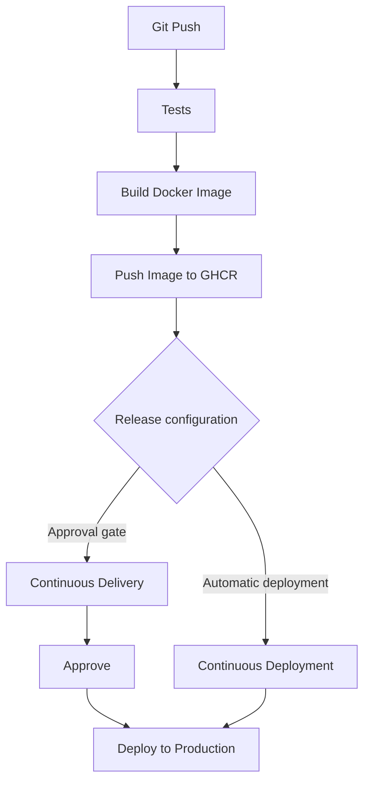

# CI/CD Pipeline User Manual
### Automated Testing, Containerization & Delivery to GitHub Container Registry (GHCR)

---

## 1. Overview & Architecture

This manual describes the automated release pipeline for microservices in this repository. The platform automates every step from the moment a developer commits code up to publishing production-ready Docker containers to GitHub Container Registry (GHCR) and managing release rollouts.

### Release Flowchart



---

## 2. Stage 1: Git Push & Triggering

### How It Works:
Whenever a developer pushes changes to the `main` branch or opens a Pull Request:
1. GitHub Actions detects the event and automatically initializes the pipeline.
2. Both microservices (`learning_service` and `order_service`) are evaluated in parallel on separate, isolated cloud environments.

### What Developers Need to Know:
* **Pushing to `main`**: Executes the complete pipeline: Tests ➔ Docker Build ➔ Smoke Testing ➔ Vulnerability Scan ➔ GHCR Publishing ➔ Deployment.
* **Pull Requests**: Executes validation stages only (Tests ➔ Docker Build & Smoke Test) to ensure code does not break the build before merging. Container images are **not** published to GHCR on unmerged PRs.

---

## 3. Stage 2: Automated Tests & Quality Gates

### Purpose:
Ensure only clean, compliant, and thoroughly tested code can progress. If any test or quality check fails, the pipeline immediately halts and prevents container creation.

### What Happens in This Stage:
1. **Dependency Installation**: The pipeline sets up Python 3.11 and installs project dependencies from `requirements.txt` using high-speed pip caching.
2. **Code Linting (Ruff)**:
   * Analyzes all Python files in milliseconds.
   * Validates PEP 8 rules, unused imports, bad syntax, and proper import ordering (`isort`).
   * If any formatting or syntax error exists, the build stops immediately.
3. **Unit & Integration Testing (Pytest)**:
   * Executes the entire test suite inside the service's `tests/` directory.
   * Every test must pass with a green checkmark (0 failures allowed).
4. **Code Coverage Enforcement (`--cov-fail-under`)**:
   * Measures the exact percentage of application code exercised by tests.
   * **`learning_service` threshold**: Must achieve at least **80% coverage**.
   * **`order_service` threshold**: Must achieve at least **85% coverage**.
   * If coverage falls even 1% below the threshold, Pytest exits with an error and blocks the build.
5. **Coverage Report Generation**:
   * Generates an interactive HTML report (`htmlcov`).
   * Uploaded as a downloadable artifact in the GitHub Actions run summary so developers can inspect uncoverable lines locally.

---

## 4. Stage 3: Build Docker Image & Runtime Verification

### Purpose:
Verify that the application does not just pass unit tests, but successfully compiles into a Linux OCI container and boots up without runtime crashes.

### What Happens in This Stage:
1. **Container Image Build**:
   * Assembles a container image using the service's `Dockerfile`.
   * Packages Python 3.11 slim runtime, application dependencies, and FastAPI source code.
2. **Automated Runtime Smoke Test**:
   * Starts the newly built container in background on the runner.
   * Waits 3 seconds for the Uvicorn ASGI web server to initialize.
   * Sends an automated HTTP GET health check request:
     * `learning_service`: `http://localhost:8000/health`
     * `order_service`: `http://localhost:8080/healthz`
   * **Strict Failure Gate**: If the server returns anything other than `HTTP 200 OK` (e.g., container crash on boot, missing environment variable, port binding error), the smoke test fails and terminates the run.
3. **Container Security Audit (Trivy)**:
   * Scans both the Linux base image layers and all Python packages for Known Vulnerabilities and Exposures (CVEs).
   * Generates a security audit table in the pipeline logs highlighting Critical and High severity issues.

---

## 5. Stage 4: Push Image to GHCR (GitHub Container Registry)

### Purpose:
Store verified, production-ready container images in a centralized, secure enterprise registry for deployment to any cloud provider or server cluster.

### What Happens in This Stage:
1. **Automated Authentication**:
   * Authenticates securely to `ghcr.io` using GitHub's built-in token (`GITHUB_TOKEN`).
   * No manual passwords or third-party registry credentials are required.
2. **OCI Lowercase Normalization**:
   * The Open Container Initiative (OCI) strictly forbids capital letters in image names.
   * The pipeline automatically converts repository owner names to lowercase (e.g., `Rampradop` ➔ `rampradop`) to avoid registry naming errors.
3. **Dual-Tag Publishing**:
   Every successful build publishes two distinct tags:
   * **`:latest`**: Dynamic pointer to the newest release on `main`.
   * **`:<git-commit-sha>`**: Immutable permanent tag mapped to the exact Git commit SHA. This guarantees full traceability and enables 1-click rollbacks to any prior release.
4. **Registry Storage Locations**:
   * Learning Service: `ghcr.io/<owner>/learning-service:latest`
   * Order Service: `ghcr.io/<owner>/order-service:latest`
   * Accessible under **GitHub ➔ Profile ➔ Packages**.

---

## 6. Stage 5: Release Configuration & Deployment Strategy

Once the image is published to GHCR, the pipeline evaluates the service's release configuration:

### Path A: Continuous Delivery (`order_service`)
* **Philosophy**: Always deliverable to production, released only with human sign-off.
* **Flow**:
  1. Image is automatically deployed and verified on **Staging**.
  2. Pipeline pauses at the **Approval Gate** (`production-manual-gate`).
  3. GitHub Actions displays a **"Review deployments"** button with status `Waiting for review`.
  4. An authorized reviewer inspects staging, clicks **Approve**, and triggers the production rollout.

### Path B: Continuous Deployment (`learning_service`)
* **Philosophy**: Fully automated from commit to production with zero human touch.
* **Flow**:
  1. Once the image is pushed to GHCR, it rolls out directly to **Production**.
  2. Bypasses all manual gates and staging pauses.
  3. Status in GitHub Actions displays green checkmark `Completed`.

---

## 7. Operator Runbook: How to Access & Run Images from GHCR

Developers and operations teams can pull and execute any published image directly from GHCR onto any computer or server.

### Step 1: Log In to GHCR Locally (One-Time Setup)
1. Generate a GitHub **Personal Access Token (Classic)** with the `read:packages` scope.
2. In your terminal, run:
   ```bash
   docker login ghcr.io -u <YOUR_GITHUB_USERNAME>
   # Paste your token when prompted for password
   ```

### Step 2: Run Learning Service (Continuous Deployment)
```bash
# Pull the latest published image
docker pull ghcr.io/<owner>/learning-service:latest

# Run on port 8000
docker run -d --name learning-api -p 8000:8000 ghcr.io/<owner>/learning-service:latest

# Verify health and interactive Swagger docs
curl http://localhost:8000/health
# Open in browser: http://localhost:8000/docs
```

### Step 3: Run Order Service (Continuous Delivery)
```bash
# Pull the latest published image
docker pull ghcr.io/<owner>/order-service:latest

# Run on port 8080
docker run -d --name order-api -p 8080:8080 ghcr.io/<owner>/order-service:latest

# Verify health and interactive Swagger docs
curl http://localhost:8080/healthz
# Open in browser: http://localhost:8080/docs
```

---

## 8. Troubleshooting Guide for Developers

| Issue | Cause | Solution |
| :--- | :--- | :--- |
| **Coverage Gate Fails** | Test coverage is below the minimum threshold (80% or 85%). | Download the `coverage-report-*` artifact from the GitHub Actions run summary, open `index.html` in a browser to see red uncovered lines, write tests for them, and push again. |
| **Smoke Test Fails** | Container crashed on startup or health route did not return HTTP 200. | Check the `Verify Container Runs (Smoke Test)` step logs in GitHub Actions to see the Uvicorn traceback or startup error. |
| **Port Conflict on Local Machine** | Container name (e.g. `/order-api`) is already in use by an existing container. | Run `docker rm -f order-api` before executing `docker run`. |
| **`invalid reference format` on Image Push** | Registry repository names must be strictly lowercase. | The pipeline handles this automatically by sanitizing the repository owner name to lowercase before pushing to GHCR. |
| **`.venv` in Git** | Local virtual environment was accidentally tracked. | Ensure `.venv/` is listed in `.gitignore`. Virtual environments are not needed in Git or Docker. |
