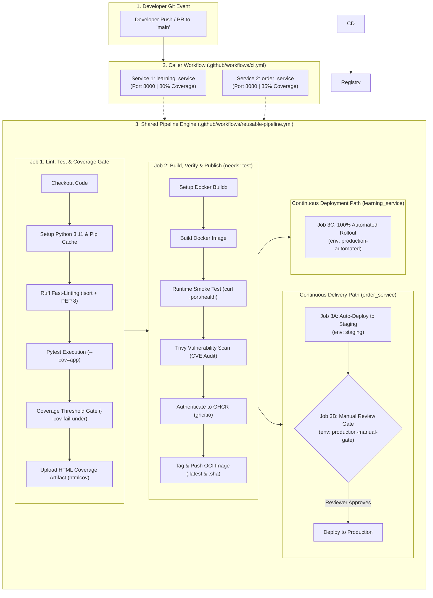

# Enterprise CI/CD Pipeline for FastAPI Microservices

A production-grade implementation guide and operational manual for evaluating, maintaining, and scaling automated Continuous Integration and Continuous Delivery (CI/CD) pipelines across FastAPI and Python microservices using GitHub Actions, Docker, and GitHub Container Registry (GHCR).

---

## 1. Scope & Platform Architecture

### Purpose
Establish a centralized, reusable CI/CD platform that eliminates duplicate pipeline scripts across microservices. The architecture enforces strict quality gates (linting, testing, code coverage limits, container smoke testing, and security scanning) while automating continuous delivery to an enterprise container registry without requiring manual DevOps intervention per service.

### Platform Architecture Diagram



---

## 2. Repository Layout & File Roles

The codebase follows an enterprise monorepo pattern where the shared CI/CD engine lives at the root `.github/` folder and each service resides in an isolated directory under `services/`:

```text
CI_CD_Pipeline/
├── .github/
│   └── workflows/
│       ├── ci.yml                    # Caller: Orchestrates multi-service pipelines in parallel
│       └── reusable-pipeline.yml     # Engine: Centralized, reusable CI/CD pipeline template
│
├── docs/
│   └── CICD_PIPELINE_GUIDE.md        # This comprehensive operational manual
│
├── services/
│   ├── learning_service/             # Microservice 1 (Port 8000, 80% Min Coverage)
│   │   ├── app/
│   │   │   └── main.py               # FastAPI application code & endpoints
│   │   ├── tests/
│   │   │   ├── __init__.py
│   │   │   └── test_learning.py      # Pytest test suite (client fixtures, route assertions)
│   │   ├── .dockerignore             # Excludes .git, __pycache__, and .venv from build context
│   │   ├── Dockerfile                # Production container specification
│   │   ├── pytest.ini                # Test path isolation and importmode configuration
│   │   └── requirements.txt          # Python dependencies
│   │
│   └── order_service/                # Microservice 2 (Port 8080, 85% Min Coverage)
│       ├── app/
│       │   └── main.py               # Order API with Pydantic schemas & routes
│       ├── tests/
│       │   ├── __init__.py
│       │   └── test_order.py         # Pytest test suite
│       ├── Dockerfile                # Production container specification
│       ├── pytest.ini                # Test path isolation and importmode configuration
│       └── requirements.txt          # Python dependencies
│
├── .gitignore                        # Global ignore rules (.venv, coverage caches, bytecode)
└── README.md                         # Quick reference & onboarding documentation
```

### Key Configuration Files Explained

| File | Purpose | Why It Exists |
| :--- | :--- | :--- |
| `pytest.ini` | Test execution configuration | Configures `pythonpath = .` and `addopts = --import-mode=importlib` to prevent `ModuleNotFoundError: No module named 'app'` when running tests across different service subdirectories. |
| `.dockerignore` | Build context filter | Prevents copying local `.venv`, `__pycache__`, `.git`, and `.coverage` artifacts into the container, slashing build times and keeping final image sizes minimal. |
| `Dockerfile` | Production container definition | Uses `python:3.11-slim`, sets non-buffering environment variables (`PYTHONDONTWRITEBYTECODE=1`, `PYTHONUNBUFFERED=1`), installs dependencies with `--no-cache-dir`, and launches Uvicorn. |

---

## 3. The Shared Pipeline Engine (`reusable-pipeline.yml`)

The engine uses GitHub Actions **`workflow_call`**, allowing any microservice to run a standardized, hardened deployment pipeline without duplicating YAML scripts.

### 1. Parameterized Inputs

```yaml
on:
  workflow_call:
    inputs:
      working-directory:
        description: "Directory containing the application code and Dockerfile"
        required: false
        type: string
        default: "."
      python-version:
        description: "Python version to use"
        required: false
        type: string
        default: "3.11"
      min-coverage:
        description: "Minimum code coverage required to pass (percentage)"
        required: false
        type: number
        default: 80
      image-name:
        description: "Docker image tag name"
        required: false
        type: string
        default: "app"
      app-port:
        description: "Port the container exposes and listens on"
        required: false
        type: number
        default: 8000
      health-endpoint:
        description: "Endpoint path to verify container health"
        required: false
        type: string
        default: "/health"
      push-image:
        description: "Whether to publish Docker image to GitHub Container Registry (ghcr.io)"
        required: false
        type: boolean
        default: true
```

---

### 2. Job 1: `test` (Code Quality, Linting & Coverage)

```yaml
jobs:
  test:
    name: Lint, Test & Coverage
    runs-on: ubuntu-latest

    steps:
      - name: Checkout caller code
        uses: actions/checkout@v4

      - name: Set up Python ${{ inputs.python-version }}
        uses: actions/setup-python@v5
        with:
          python-version: ${{ inputs.python-version }}
          cache: "pip"
          cache-dependency-path: "${{ inputs.working-directory }}/requirements.txt"

      - name: Install dependencies & linter
        working-directory: ${{ inputs.working-directory }}
        run: |
          python -m pip install --upgrade pip
          pip install ruff
          pip install -r requirements.txt

      - name: Lint with Ruff (Fail fast on syntax/style issues)
        working-directory: ${{ inputs.working-directory }}
        run: |
          ruff check .

      - name: Run Pytest with HTML Coverage Report
        working-directory: ${{ inputs.working-directory }}
        run: |
          pytest tests/ --import-mode=importlib --cov=app --cov-report=term-missing --cov-report=html:htmlcov --cov-fail-under=${{ inputs.min-coverage }}

      - name: Upload Test Coverage Artifact
        uses: actions/upload-artifact@v4
        with:
          name: coverage-report-${{ inputs.image-name }}
          path: ${{ inputs.working-directory }}/htmlcov/
```

#### What Happens in Job 1:
1. **Pip Caching (`cache: "pip"`)**: Hashes `requirements.txt` and reuses cached wheel downloads across workflow runs, cutting setup time from ~40s to ~4s.
2. **Fast Linting with Ruff (`ruff check .`)**: Runs in <1 second. Immediately stops the pipeline if unused imports, syntax errors, or PEP 8 formatting violations exist.
3. **Coverage Gating (`--cov-fail-under`)**: Runs all tests. If test coverage falls below the parameterized threshold (80% or 85%), Pytest exits with status code `1`, immediately aborting the build.
4. **HTML Artifact Upload**: Saves the full HTML report (`htmlcov/`) so developers can inspect uncovered lines without reproducing tests locally.

---

### 3. Job 2: `docker-build` (Build, Smoke Test, Security Scan & Deliver)

```yaml
  docker-build:
    name: Build, Verify & Publish Container
    needs: test                     # Runs ONLY if lint, tests & coverage pass 100%
    runs-on: ubuntu-latest
    permissions:
      contents: read
      packages: write

    steps:
      - name: Checkout caller code
        uses: actions/checkout@v4

      - name: Set up Docker Buildx
        uses: docker/setup-buildx-action@v3

      - name: Build Docker Image
        working-directory: ${{ inputs.working-directory }}
        run: |
          docker build -t ${{ inputs.image-name }}:latest .

      - name: Verify Container Runs (Smoke Test)
        run: |
          # 1. Start the container in background
          docker run -d --name test-container -p ${{ inputs.app-port }}:${{ inputs.app-port }} ${{ inputs.image-name }}:latest
          
          # 2. Wait for server to initialize
          sleep 3
          
          # 3. Hit the health endpoint
          curl --fail http://localhost:${{ inputs.app-port }}${{ inputs.health-endpoint }}
          
          # 4. Cleanup
          docker stop test-container
          docker rm test-container

      - name: Scan Docker Image for Vulnerabilities (Trivy)
        uses: aquasecurity/trivy-action@master
        with:
          image-ref: ${{ inputs.image-name }}:latest
          format: "table"
          exit-code: "0" # Audit mode: reports CVEs in pipeline logs
          severity: "CRITICAL,HIGH"

      - name: Log in to GitHub Container Registry (GHCR)
        if: inputs.push-image && (github.ref == 'refs/heads/main' || github.event_name == 'release')
        uses: docker/login-action@v3
        with:
          registry: ghcr.io
          username: ${{ github.actor }}
          password: ${{ secrets.GITHUB_TOKEN }}

      - name: Tag and Publish Image to GHCR (Continuous Delivery)
        if: inputs.push-image && (github.ref == 'refs/heads/main' || github.event_name == 'release')
        run: |
          # Lowercase repository owner for OCI registry compliance
          OWNER_LOWER=$(echo "${{ github.repository_owner }}" | tr '[:upper:]' '[:lower:]')
          IMAGE_URI="ghcr.io/${OWNER_LOWER}/${{ inputs.image-name }}"
          
          docker tag ${{ inputs.image-name }}:latest ${IMAGE_URI}:latest
          docker tag ${{ inputs.image-name }}:latest ${IMAGE_URI}:${{ github.sha }}
          
          docker push ${IMAGE_URI}:latest
          docker push ${IMAGE_URI}:${{ github.sha }}
          echo "🚀 Successfully pushed: ${IMAGE_URI}:${{ github.sha }}"
```

#### What Happens in Job 2:
1. **Dependency Gate (`needs: test`)**: Ensures broken code or uncovered branches are never packaged into a container.
2. **Runtime Smoke Test**: Starts the real container on the runner, waits for Uvicorn to boot, and curls the health route (`curl --fail`). If the container crashes on startup (e.g. missing environment variable or bad import), the build fails immediately.
3. **Trivy Vulnerability Audit**: Scans both the Linux Debian base image and Python packages for High/Critical CVEs.
4. **Automatic Authentication (`secrets.GITHUB_TOKEN`)**: Uses GitHub's built-in short-lived workflow token with `packages: write` scope. No manual secrets or personal access tokens are stored in the repo.
5. **OCI Standard Tagging**: Automatically converts repository owners with capital letters to lowercase (e.g., `Rampradop` -> `rampradop`), tags `:latest` and the immutable Git commit SHA (`:${{ github.sha }}`), and pushes to `ghcr.io`.

---

### 4. Job 3A: `deploy-staging` (Continuous Delivery - Auto-Deploy to Staging)

When `deployment-type: "delivery"` is passed, the pipeline runs this job immediately after Job 2 publishes the container:

```yaml
  deploy-staging:
    name: "CD (Delivery): Auto-Deploy to Staging"
    needs: docker-build
    if: inputs.deployment-type == 'delivery' && (github.ref == 'refs/heads/main' || github.event_name == 'release')
    runs-on: ubuntu-latest
    environment:
      name: staging
      url: http://staging.internal:${{ inputs.app-port }}${{ inputs.health-endpoint }}

    steps:
      - name: Deploy Container to Staging Environment
        run: |
          OWNER_LOWER=$(echo "${{ github.repository_owner }}" | tr '[:upper:]' '[:lower:]')
          IMAGE_URI="ghcr.io/${OWNER_LOWER}/${{ inputs.image-name }}:${{ github.sha }}"
          docker run -d --name staging-app -p ${{ inputs.app-port }}:${{ inputs.app-port }} ${IMAGE_URI}
          sleep 3
          curl --fail http://localhost:${{ inputs.app-port }}${{ inputs.health-endpoint }}
          docker stop staging-app
```

#### What Happens:
* Deploys the newly published image (`ghcr.io/<owner>/order-service:<sha>`) directly into the **Staging environment**.
* Automatically verifies that the staging deployment is responsive and passes health checks.
* Sets up a verified deployable candidate ready for human sign-off.

---

### 5. Job 3B: `deploy-production-gated` (Continuous Delivery - Manual Approval Gate)

This is the hallmark of **Continuous Delivery**. The pipeline **pauses** and enters a `waiting` state, requiring an authorized team lead or DevOps engineer to click **"Review deployments" -> "Approve and deploy"**:

```yaml
  deploy-production-gated:
    name: "CD (Delivery): Production Release (Manual Approval)"
    needs: deploy-staging
    if: inputs.deployment-type == 'delivery' && (github.ref == 'refs/heads/main' || github.event_name == 'release')
    runs-on: ubuntu-latest
    environment:
      name: production-manual-gate
      url: http://production.internal:${{ inputs.app-port }}${{ inputs.health-endpoint }}

    steps:
      - name: Deploy Container to Production Environment (After Approval)
        run: |
          OWNER_LOWER=$(echo "${{ github.repository_owner }}" | tr '[:upper:]' '[:lower:]')
          IMAGE_URI="ghcr.io/${OWNER_LOWER}/${{ inputs.image-name }}:${{ github.sha }}"
          echo "🚀 Approval received from authorized reviewer!"
          docker run -d --name prod-app -p ${{ inputs.app-port }}:${{ inputs.app-port }} ${IMAGE_URI}
          sleep 3
          curl --fail http://localhost:${{ inputs.app-port }}${{ inputs.health-endpoint }}
          docker stop prod-app
```

#### What Happens:
* **GitHub Environment Protection Rule**: Bound to the GitHub environment `production-manual-gate`.
* Execution stops and waits indefinitely (or until timeout) for approval.
* Once approved, the runner spins up and executes the production rollout.

---

### 6. Job 3C: `deploy-production-automated` (Continuous Deployment - 100% Automated Rollout)

When `deployment-type: "deployment"` is selected (used by `learning_service`), all intermediate stops and human gates are bypassed:

```yaml
  deploy-production-automated:
    name: "CD (Deployment): 100% Automated Production Rollout"
    needs: docker-build
    if: inputs.deployment-type == 'deployment' && (github.ref == 'refs/heads/main' || github.event_name == 'release')
    runs-on: ubuntu-latest
    environment:
      name: production-automated
      url: http://production.internal:${{ inputs.app-port }}${{ inputs.health-endpoint }}

    steps:
      - name: Deploy Container Directly to Production (Zero Human Touch)
        run: |
          OWNER_LOWER=$(echo "${{ github.repository_owner }}" | tr '[:upper:]' '[:lower:]')
          IMAGE_URI="ghcr.io/${OWNER_LOWER}/${{ inputs.image-name }}:${{ github.sha }}"
          echo "⚡ Continuous Deployment mode active: Zero human intervention required."
          docker run -d --name prod-auto-app -p ${{ inputs.app-port }}:${{ inputs.app-port }} ${IMAGE_URI}
          sleep 3
          curl --fail http://localhost:${{ inputs.app-port }}${{ inputs.health-endpoint }}
          docker stop prod-auto-app
```

#### What Happens:
* As soon as Job 2 publishes the container to GHCR, Job 3C runs immediately.
* Rolls out the update to production without any human approval or delay.

---

### 7. Continuous Delivery vs. Continuous Deployment: Deep Dive & Comparison

| Dimension | Continuous Delivery (CD) | Continuous Deployment (CD) |
| :--- | :--- | :--- |
| **Microservice in Repo** | `order_service` (Critical Business/Financial Data) | `learning_service` (Experimental/Fast-Moving API) |
| **Pipeline Input** | `deployment-type: "delivery"` | `deployment-type: "deployment"` |
| **Staging Deployment** | **Automated** (Job 3A) | Skipped (or integrated into direct deployment) |
| **Production Rollout** | **Manual Approval Gate** (Job 3B pauses & waits for review) | **100% Automated** (Job 3C deploys immediately) |
| **Human Decision Point** | **Yes**: Business, QA, or Product Lead sign-off | **No**: Zero human touch |
| **GitHub Action State** | Shows `Waiting for review` with review modal | Shows green checkmark `Completed` immediately |
| **Typical Industry Use Case** | Payments, Checkout, Banking, Healthcare APIs | Content sites, internal tools, micro-APIs, feature-flagged apps |

---

## 4. The Orchestrator / Caller (`ci.yml`)

The caller workflow binds the microservices together and runs them in parallel:

```yaml
name: Multi-Project CI/CD Pipeline

on:
  push:
    branches: [ "main" ]
  pull_request:
    branches: [ "main" ]

permissions:
  contents: read
  packages: write

jobs:
  # ==========================================================
  # PROJECT 1: Learning Service (services/learning_service)
  # MODEL: CONTINUOUS DEPLOYMENT (100% Automated to Production)
  # Uses Python 3.11, Port 8000, /health route, 80% coverage
  # ==========================================================
  learning-service-ci:
    name: "Project 1: Learning Service (Continuous Deployment)"
    uses: ./.github/workflows/reusable-pipeline.yml
    with:
      working-directory: "services/learning_service"
      python-version: "3.11"
      min-coverage: 80
      image-name: "learning-service"
      app-port: 8000
      health-endpoint: "/health"
      push-image: true
      deployment-type: "deployment"

  # ==========================================================
  # PROJECT 2: Order Service (services/order_service)
  # MODEL: CONTINUOUS DELIVERY (Automated Staging + Manual Approval Gate)
  # Uses Python 3.11, Port 8080, /healthz route, 85% coverage
  # ==========================================================
  order-service-ci:
    name: "Project 2: Order Service (Continuous Delivery)"
    uses: ./.github/workflows/reusable-pipeline.yml
    with:
      working-directory: "services/order_service"
      python-version: "3.11"
      min-coverage: 85
      image-name: "order-service"
      app-port: 8080
      health-endpoint: "/healthz"
      push-image: true
      deployment-type: "delivery"
```

---

## 5. How to Add a New Microservice (in 3 Minutes)

Because the pipeline is centralized, onboarding a new service requires zero pipeline re-writes:

1. **Create the service directory**:
   ```text
   services/payment_service/
   ├── app/
   │   └── main.py
   ├── tests/
   │   └── test_payment.py
   ├── Dockerfile
   ├── pytest.ini
   └── requirements.txt
   ```
2. **Register the service in `.github/workflows/ci.yml`**:
   ```yaml
     payment-service-ci:
       name: "Project 3: Payment Service"
       uses: ./.github/workflows/reusable-pipeline.yml
       with:
         working-directory: "services/payment_service"
         python-version: "3.11"
         min-coverage: 80
         image-name: "payment-service"
         app-port: 9000
         health-endpoint: "/health"
         push-image: true
   ```
3. **Commit & Push**:
   ```powershell
   git add .
   git commit -m "feat: onboard payment_service to CI/CD pipeline"
   git push origin main
   ```
   GitHub Actions will instantly spin up a dedicated parallel runner, lint, test, smoke test, and deliver `ghcr.io/rampradops28/payment-service:latest`.

---

## 6. Verification & Runbook Guide

### 1. Inspecting Live Runs on GitHub
1. Open your repository's Actions tab:  
   👉 [**https://github.com/rampradops28/CI_CD_Pipeline/actions**](https://github.com/rampradops28/CI_CD_Pipeline/actions)
2. Select any workflow run. Both services will display green checkmarks across all phases:
   * `Lint, Test & Coverage`
   * `Build, Verify & Publish Container`
3. Scroll to the bottom under **Artifacts** to download `coverage-report-learning-service` or `coverage-report-order-service`.

---

### 2. Authenticating Locally with GHCR

> [!NOTE]
> Newly created packages on GHCR are set to **Private** by default. To pull them to your local Docker workstation, authenticate once using a GitHub Personal Access Token (PAT).

#### Step 1: Create a Personal Access Token (Classic)
1. Go to **GitHub Settings** -> **Developer Settings** -> **Personal access tokens** -> **Tokens (classic)**:  
   👉 [**https://github.com/settings/tokens**](https://github.com/settings/tokens)
2. Click **Generate new token (classic)**.
3. Note: `GHCR Docker CLI`.
4. Check **`write:packages`** (which automatically selects **`read:packages`**).
5. Click **Generate token** and copy the resulting string (`ghp_...`).

#### Step 2: Log in via Docker CLI
In your PowerShell terminal:
```powershell
docker login ghcr.io -u rampradops28
# When prompted for Password, paste your ghp_... token
```
**Output:** `Login Succeeded`

---

### 3. Pulling & Running Published Images Locally

#### Service 1: Learning Service (Port 8000)
```powershell
# Clean up any old container with the same name
docker rm -f learning-api 2>$null

# Pull the latest image published by CI/CD
docker pull ghcr.io/rampradops28/learning-service:latest

# Run the container in background
docker run -d --name learning-api -p 8000:8000 ghcr.io/rampradops28/learning-service:latest

# Verify live health
curl http://localhost:8000/health
# {"status":"healthy"}

# Interactive API Docs
# Open http://localhost:8000/docs
```

#### Service 2: Order Service (Port 8080)
```powershell
# Clean up any old container with the same name
docker rm -f order-api 2>$null

# Pull the latest image published by CI/CD
docker pull ghcr.io/rampradops28/order-service:latest

# Run the container in background
docker run -d --name order-api -p 8080:8080 ghcr.io/rampradops28/order-service:latest

# Verify live health
curl http://localhost:8080/healthz
# {"status":"ok","service":"order-service"}

# Interactive API Docs
# Open http://localhost:8080/docs
```

---

### 4. Approving Gated Production Releases in GitHub Actions UI

When `order_service` executes its Continuous Delivery pipeline:
1. Navigate to GitHub: **Actions** -> Select the active workflow run.
2. In the workflow graph, notice `CD (Delivery): Production Release (Manual Approval)` has an amber/yellow icon with label **"Waiting for review"**.
3. At the top of the workflow page, a notification banner displays:
   > **1 environment waiting for review: production-manual-gate**
4. Click the **"Review deployments"** button.
5. In the modal dialog:
   - Check the checkbox next to **`production-manual-gate`**.
   - (Optional) Add a comment: *"Staging verified, approving production release."*
   - Click the green button: **"Approve and deploy"**.
6. The job immediately activates, pulls the container from GHCR, and finishes the production rollout!

---

## 7. Troubleshooting & Operational FAQ

| Symptom / Error | Root Cause | Solution |
| :--- | :--- | :--- |
| `docker: Conflict. The container name "/learning-api" is already in use` | A previous stopped or running container is still holding that name. | Run `docker rm -f learning-api` before starting the container. |
| `invalid reference format: repository name must be lowercase` | Docker and OCI registries forbid capital letters in image names, but GitHub usernames often contain capitals. | In `reusable-pipeline.yml`, the pipeline converts the username with `OWNER_LOWER=$(echo "${{ github.repository_owner }}" \| tr '[:upper:]' '[:lower:]')`. |
| `I001 [*] Import block is un-sorted` during Ruff linting | In PEP 8 / isort rules, third-party imports (like `fastapi.testclient`) must be listed before local imports (like `from app.main import app`), separated by a blank line. | Run `ruff check --fix .` locally to auto-order imports before pushing. |
| `FAIL Required test coverage of X% not reached` | New routes were added to `main.py` without writing corresponding tests in `tests/`. | Add unit test assertions in `tests/test_*.py` until coverage meets the threshold. |
| `docker pull: unauthorized` | The package on GHCR is private and Docker is not authenticated. | Run `docker login ghcr.io -u <username>` with a GitHub PAT containing `read:packages`. (Or make the package Public in GitHub Package Settings). |

---

## 8. Summary & Quick Reference

1. **Single Source of Truth**: All testing, coverage, Docker, and delivery logic lives in `.github/workflows/reusable-pipeline.yml`.
2. **Quality-First CI**: Code cannot merge or build into a container unless Ruff passes, 100% of Pytest tests pass, and coverage is above 80%/85%.
3. **Verified CD**: Containers are automatically smoke-tested live via HTTP and scanned for CVEs before being published to `ghcr.io`.
4. **Immutable Versioning**: Images are always tagged with both `:latest` and their unique commit hash `:${{ github.sha }}` for reliable rollbacks.
5. **Zero Duplicate Scripts**: Every new microservice added in `services/` inherits the full enterprise pipeline in just 10 lines of YAML configuration.
