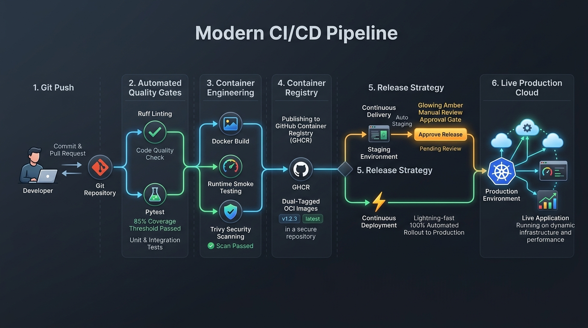
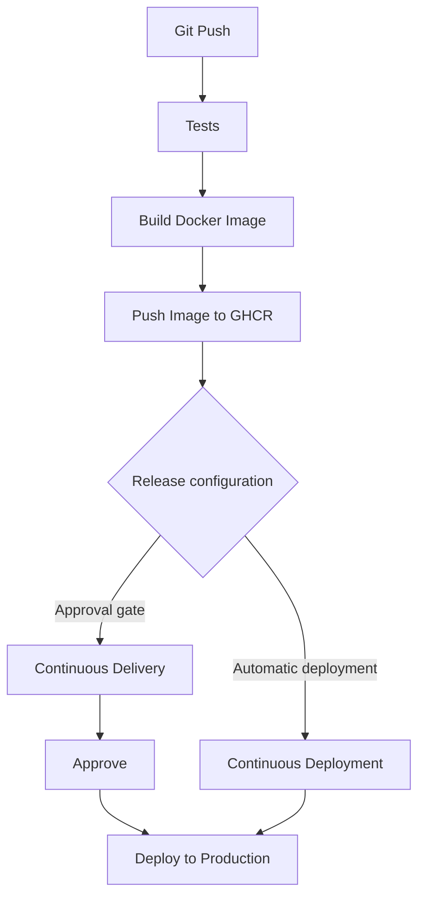

# CI/CD Pipeline User Manual
### Automated Quality Verification, Containerization & Delivery to Container Registry (GHCR)

---

## 1. Overview & Architecture



This user manual describes the automated release pipeline designed for containerized microservices. The pipeline standardizes software delivery across all services—from developer commit to container publishing and multi-environment deployment.

### Release Flowchart



---

## 2. Stage 1: Git Push & Triggering

### How It Works:
Whenever a developer commits code to the primary branch (`main`) or opens a Pull Request:
1. The CI/CD system detects the event and automatically initializes the pipeline.
2. Each configured service runs through an isolated, parallel build and verification job.

### Trigger Behavior:
* **Push to Default Branch (`main`)**: Executes the end-to-end pipeline: Automated Tests ➔ Container Build & Smoke Test ➔ Security Scan ➔ Registry Publishing (GHCR) ➔ Deployment.
* **Pull Requests**: Executes quality validation only (Tests ➔ Container Build & Smoke Test). Container images are **not** published to the registry on unmerged PRs.

---

## 3. Stage 2: Automated Tests & Quality Gates

### Purpose:
Enforce strict quality and testing standards before any software is packaged into a container. If any check fails, the pipeline halts immediately, preventing defective builds from reaching the registry.

### What Happens in This Stage:
1. **Environment Setup & Dependency Caching**: The pipeline provisions a clean runtime environment and installs project dependencies using automated package caching.
2. **Code Linting & Formatting**:
   * Analyzes all source files for syntax errors, formatting compliance (PEP 8), unused imports, and import ordering conventions.
   * Fails fast within seconds if formatting or style violations are detected.
3. **Automated Test Suite**:
   * Executes all unit and integration tests defined within the service test directory.
   * Zero test failures tolerated (all tests must pass).
4. **Code Coverage Enforcement**:
   * Measures the percentage of application lines covered by automated tests.
   * Evaluates coverage against the service's configured minimum threshold (e.g. 80% or 85%).
   * If coverage falls below the required threshold, the build is rejected immediately.
5. **Coverage Report Generation**:
   * Generates a detailed HTML coverage report.
   * Uploaded as a downloadable workflow artifact so developers can review uncovered code paths directly.

---

## 4. Stage 3: Build Docker Image & Runtime Verification

### Purpose:
Ensure the application packages cleanly into an Open Container Initiative (OCI) image and boots properly in an isolated container environment.

### What Happens in This Stage:
1. **Container Image Build**:
   * Assembles the container image using the service `Dockerfile`.
   * Packages runtime dependencies, system packages, and application source code.
2. **Automated Runtime Smoke Test**:
   * Launches the newly built container in background on the runner.
   * Waits for the application web server to initialize.
   * Issues an automated HTTP GET health check request against the configured health route:
     `http://localhost:<app-port><health-endpoint>`
   * **Verification Gate**: If the application crashes on boot, fails to bind to its port, or returns an error status (non-200), the smoke test fails and stops the pipeline.
3. **Vulnerability Scanning**:
   * Audits the container image layers and installed third-party libraries for Known Vulnerabilities and Exposures (CVEs).
   * Generates an audit report in the build logs highlighting Critical and High severity issues.

---

## 5. Stage 4: Push Image to GHCR (GitHub Container Registry)

### Purpose:
Publish verified, immutable container images to a centralized enterprise registry accessible by deployment targets and development teams.

### What Happens in This Stage:
1. **Automated Authentication**:
   * Authenticates securely to `ghcr.io` using built-in runner credentials.
   * No static credentials or external passwords required.
2. **OCI Standard Lowercase Compliance**:
   * The OCI specification requires registry repository names to be strictly lowercase.
   * The pipeline automatically normalizes repository identifiers to lowercase to prevent naming format errors.
3. **Dual-Tag Publishing Strategy**:
   Every successful build publishes two distinct tags:
   * **`:latest`**: Dynamic pointer to the newest successful build on the primary branch.
   * **`:<git-commit-sha>`**: Immutable permanent tag mapped to the exact Git commit SHA. This provides a complete audit trail and enables instant rollback to any prior release.
4. **Image Registry Format**:
   ```text
   ghcr.io/<organization-or-user>/<service-name>:latest
   ghcr.io/<organization-or-user>/<service-name>:<commit-sha>
   ```

---

## 6. Stage 5: Release Configuration & Deployment Strategy

Once the verified image is published to the registry, the release configuration determines how the software reaches production:

### Path A: Continuous Delivery (Gated Release)
* **Philosophy**: The artifact is always production-ready, but actual production rollout requires human authorization.
* **Process**:
  1. The container image is automatically deployed to a **Staging** environment for verification.
  2. The pipeline reaches an **Approval Gate** and pauses with status `Waiting for review`.
  3. Authorized reviewers receive a notification and inspect the deployment.
  4. Upon manual approval, the pipeline executes the rollout to **Production**.

### Path B: Continuous Deployment (Automated Release)
* **Philosophy**: Every commit that passes quality, testing, and security gates is rolled out to production with zero manual intervention.
* **Process**:
  1. Once the image is pushed to the registry, the pipeline proceeds directly to **Production**.
  2. No human gates or approval stops.
  3. The service status updates to `Completed` automatically.

---

## 7. Operator Runbook: Running Images from Registry

Developers and platform engineers can pull and run any published image on local machines or remote servers:

### Step 1: Registry Authentication (One-Time Setup)
```bash
docker login ghcr.io -u <YOUR_GITHUB_USERNAME>
# Enter a Personal Access Token with 'read:packages' permission
```

### Step 2: Pull and Run Any Service Container
```bash
# Pull the latest published image
docker pull ghcr.io/<organization>/<service-name>:latest

# Run the container with appropriate port mapping
docker run -d --name <container-name> -p <host-port>:<app-port> ghcr.io/<organization>/<service-name>:latest

# Verify service health
curl http://localhost:<host-port><health-endpoint>
```

---

## 8. Troubleshooting Guide

| Issue | Root Cause | Recommended Action |
| :--- | :--- | :--- |
| **Coverage Threshold Failure** | Test coverage percentage is below the service's configured minimum limit. | Download the coverage artifact from the build summary, open `index.html` to locate uncovered lines, write unit tests for the missing paths, and push an update. |
| **Smoke Test Failure** | Container exited unexpectedly during startup or the health endpoint failed. | Review the smoke test logs in the CI run to inspect server tracebacks, port configurations, or missing dependencies. |
| **Local Port Conflict** | Container name or host port is already allocated by another running container. | Stop and remove the existing container using `docker rm -f <container-name>` before re-running. |
| **Registry Casing Error** | Registry names contain uppercase characters. | Ensure all repository paths in image tags use lowercase characters according to OCI specifications. |
| **Virtual Environment in Repository** | Local virtual environment folder (`.venv`) committed or staged. | Add `.venv/` to `.gitignore`. Virtual environments should never be committed; the CI pipeline and Docker build clean environments from dependency manifests. |
