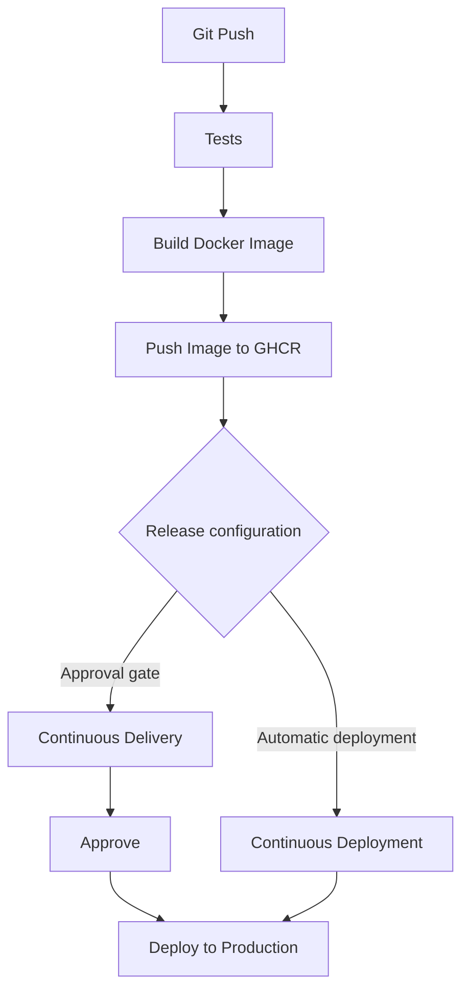

# Enterprise CI/CD & Delivery Engineering Manual
### FastAPI Microservices, Reusable GitHub Actions, Docker OCI & Multi-Strategy Deployment

---

## Document Control & System Specifications

| Specification | Details |
| :--- | :--- |
| **System** | Reusable Multi-Project CI/CD Platform |
| **Runtime Target** | Python 3.11 / FastAPI / Docker Linux OCI |
| **CI/CD Engine** | GitHub Actions Reusable Workflows (`reusable-pipeline.yml`) |
| **Artifact Registry** | GitHub Container Registry (`ghcr.io`) |
| **Target Workspaces** | `services/learning_service`, `services/order_service` |
| **Deployment Strategies** | Continuous Delivery (Manual Gate) & Continuous Deployment (Zero-Touch) |
| **Security Auditing** | Ruff Linter, Trivy Container Scanner, Pytest Coverage Fail-Under |

---

## 1. High-Level Release Lifecycle Architecture

Every code change committed to the repository undergoes an automated multi-stage pipeline. The delivery and deployment flow is illustrated below:



### Architectural Flowchart Breakdown

1. **`Git Push`**: Developer pushes a commit or creates a Pull Request targeted at the `main` branch.
2. **`Tests`**: Code quality is validated through syntax linting (Ruff), unit testing (Pytest), and strict coverage enforcement (`--cov-fail-under`).
3. **`Build Docker Image`**: An immutable Linux OCI container is built and verified via a live local runtime smoke test (`curl --fail`).
4. **`Push Image to GHCR`**: Trivy audits vulnerabilities, and the verified image is published to GitHub Container Registry (`ghcr.io`).
5. **`Release configuration`**: The pipeline branches based on the `deployment-type` parameter:
   * **`Continuous Delivery`** (`order_service`): Deploys automatically to Staging, then pauses at an **Approval Gate** awaiting human authorization.
   * **`Continuous Deployment`** (`learning_service`): Completely automated, zero-touch rollout directly to Production.
6. **`Deploy to Production`**: The production environment is updated with the verified release artifact.

---

## 2. Deep Dive: Core Pipeline Stages (Git Push to GHCR & Production)

### Stage 1: Git Push & Event Triggering
The workflow is triggered via GitHub events defined in `.github/workflows/ci.yml`:
* **`push` on `main`**: Runs the complete CI pipeline, publishes the container to GHCR, and executes the designated deployment strategy.
* **`pull_request` on `main`**: Runs linting, tests, coverage verification, and Docker build/smoke tests. Container publishing to GHCR is safely skipped on unmerged PRs.

```yaml
permissions:
  contents: read      # Read repository source code
  packages: write     # Publish OCI container packages to GHCR
```

---

### Stage 2: Automated Tests & Quality Gates (`Job 1: test`)

Before any Docker image is built, the code must pass three non-negotiable quality barriers in an isolated runner:

```yaml
  test:
    name: Lint, Test & Coverage
    runs-on: ubuntu-latest

    steps:
      - name: Checkout caller code
        uses: actions/checkout@v4

      - name: Set up Python ${{ inputs.python-version }}
        uses: actions/setup-python@v5
        with:
          python-version: ${{ inputs.python-version }}
          cache: "pip"
          cache-dependency-path: "${{ inputs.working-directory }}/requirements.txt"

      - name: Install dependencies
        run: |
          python -m pip install --upgrade pip
          pip install -r ${{ inputs.working-directory }}/requirements.txt

      - name: Lint with Ruff (Fail fast on syntax/style issues)
        working-directory: ${{ inputs.working-directory }}
        run: |
          ruff check .

      - name: Run Pytest with HTML Coverage Report
        working-directory: ${{ inputs.working-directory }}
        run: |
          pytest tests/ --import-mode=importlib --cov=app --cov-report=term-missing --cov-report=html:htmlcov --cov-fail-under=${{ inputs.min-coverage }}

      - name: Upload Test Coverage Artifact
        uses: actions/upload-artifact@v4
        with:
          name: coverage-report-${{ inputs.image-name }}
          path: ${{ inputs.working-directory }}/htmlcov/
```

#### Quality Gate Specifications:
1. **Pip Caching (`cache: "pip"`)**: Reuses cached Python wheels across workflow runs, cutting setup time from ~40s to ~3s.
2. **Fast Linting with Ruff (`ruff check .`)**: Validates PEP 8 rules, unused imports, syntax errors, and isort conventions in milliseconds. If any violation exists, the pipeline halts immediately.
3. **Strict Coverage Threshold (`--cov-fail-under`)**:
   * `learning_service`: Enforces **80% minimum coverage**.
   * `order_service`: Enforces **85% minimum coverage**.
   * If a developer adds business logic without unit tests, Pytest exits with status code `1`, preventing Docker builds.
4. **HTML Coverage Reports**: Uploaded as workflow artifacts so developers can download and inspect uncoverable lines locally.

---

### Stage 3: Container Engineering & Smoke Testing (`Job 2: docker-build`)

A green test suite guarantees business logic, but container runtime failures (missing dependencies, unexposed ports, broken entrypoints) can still occur. Job 2 compiles and executes a real-world container test:

```yaml
      - name: Build Docker Image
        working-directory: ${{ inputs.working-directory }}
        run: |
          docker build -t ${{ inputs.image-name }}:latest .

      - name: Verify Container Runs (Smoke Test)
        run: |
          # 1. Start container on the runner
          docker run -d --name test-container -p ${{ inputs.app-port }}:${{ inputs.app-port }} ${{ inputs.image-name }}:latest
          
          # 2. Wait 3 seconds for Uvicorn server initialization
          sleep 3
          
          # 3. Hit health endpoint using HTTP GET
          curl --fail http://localhost:${{ inputs.app-port }}${{ inputs.health-endpoint }}
          
          # 4. Clean up container
          docker stop test-container
          docker rm test-container
```

* **Smoke Test Verification**: Starts the newly built container, curls `http://localhost:<port><endpoint>`, and fails the build if the endpoint does not return HTTP 200.

---

### Stage 4: Container Security Vulnerability Scanning (Trivy)

Before any image is pushed to the enterprise registry, it is scanned for Common Vulnerabilities and Exposures (CVEs) across operating system packages and application dependencies:

```yaml
      - name: Scan Docker Image for Vulnerabilities (Trivy)
        uses: aquasecurity/trivy-action@master
        with:
          image-ref: ${{ inputs.image-name }}:latest
          format: "table"
          exit-code: "0" # Audit mode: reports CVEs in pipeline logs
          severity: "CRITICAL,HIGH"
```

* Scans the base image (Debian/Alpine) and installed Python packages.
* Outputs tabular reports of CVEs directly into pipeline logs.

---

### Stage 5: Publishing to GitHub Container Registry (GHCR)

Once all quality and security gates pass, the container is published to GitHub Container Registry:

```yaml
      - name: Log in to GitHub Container Registry (GHCR)
        if: inputs.push-image && (github.ref == 'refs/heads/main' || github.event_name == 'release')
        uses: docker/login-action@v3
        with:
          registry: ghcr.io
          username: ${{ github.actor }}
          password: ${{ secrets.GITHUB_TOKEN }}

      - name: Tag and Publish Image to GHCR (Continuous Delivery)
        if: inputs.push-image && (github.ref == 'refs/heads/main' || github.event_name == 'release')
        run: |
          # Lowercase repository owner for OCI registry compliance
          OWNER_LOWER=$(echo "${{ github.repository_owner }}" | tr '[:upper:]' '[:lower:]')
          IMAGE_URI="ghcr.io/${OWNER_LOWER}/${{ inputs.image-name }}"
          
          docker tag ${{ inputs.image-name }}:latest ${IMAGE_URI}:latest
          docker tag ${{ inputs.image-name }}:latest ${IMAGE_URI}:${{ github.sha }}
          
          docker push ${IMAGE_URI}:latest
          docker push ${IMAGE_URI}:${{ github.sha }}
          echo "🚀 Successfully pushed: ${IMAGE_URI}:${{ github.sha }}"
```

#### The OCI Lowercase Compliance Mandate:
The Open Container Initiative (OCI) specification strictly forbids uppercase characters in repository paths. If a GitHub username contains capital letters (e.g. `Rampradop`), running `docker push ghcr.io/Rampradop/...` crashes with:
```text
invalid reference format: repository name must be lowercase
```
The pipeline automatically converts the repository owner to lowercase using `tr '[:upper:]' '[:lower:]'`, ensuring builds never fail due to casing.

#### Dual-Tagging Strategy:
1. **`:latest`**: Dynamic tag pointing to the newest successful build on `main`.
2. **`:${{ github.sha }}`**: Immutable tag mapped to the exact Git commit SHA. This allows instant rollback to any previous version.

---

### Stage 6: Release Configuration & Deployment Strategy

The pipeline supports two distinct operational release patterns controlled by `deployment-type`:

```
                       ┌─────────────────────────┐
                       │  Release Configuration  │
                       └────────────┬────────────┘
                                    │
               ┌────────────────────┴────────────────────┐
               ▼                                         ▼
   ┌───────────────────────┐                 ┌───────────────────────┐
   │  Continuous Delivery  │                 │ Continuous Deployment │
   │    (order_service)    │                 │   (learning_service)  │
   └───────────┬───────────┘                 └───────────┬───────────┘
               │                                         │
   1. Auto-Deploy to Staging                 1. 100% Automated Rollout
   2. ⏸️ Manual Approval Gate                   Direct to Production
   3. Reviewer Clicks Approve                            │
   4. Deploy to Production                               │
               │                                         │
               └────────────────────┬────────────────────┘
                                    ▼
                         [ Deploy to Production ]
```

#### Strategy A: Continuous Delivery (`order_service`)
* **Job 3A (`deploy-staging`)**: Automatically deploys the image to the `staging` environment.
* **Job 3B (`deploy-production-gated`)**: Bound to GitHub Environment `production-manual-gate`. The workflow enters a `waiting` state, displaying a **"Review deployments"** button in GitHub Actions.
* **Production Deployment**: Occurs **only** after an authorized team lead or engineer approves the release.

#### Strategy B: Continuous Deployment (`learning_service`)
* **Job 3C (`deploy-production-automated`)**: Bound to GitHub Environment `production-automated`.
* As soon as Job 2 publishes the container to GHCR, Job 3C deploys directly to Production without human intervention.

---

## 3. Comparison Matrix: Continuous Delivery vs. Continuous Deployment

| Dimension | Continuous Delivery (CD) | Continuous Deployment (CD) |
| :--- | :--- | :--- |
| **Service in Repo** | `order_service` | `learning_service` |
| **Pipeline Parameter** | `deployment-type: "delivery"` | `deployment-type: "deployment"` |
| **Staging Environment** | **Automated** (Job 3A) | Skipped / Direct |
| **Production Gate** | **Manual Review Gate** (Job 3B pauses & waits) | **Zero-Touch Automation** (Job 3C deploys instantly) |
| **Human Decision Point** | **Yes**: QA, Product, or Lead sign-off | **No**: Zero human intervention |
| **GitHub Actions UI** | Shows amber icon: `Waiting for review` | Shows green checkmark: `Completed` |
| **Best Used For** | Payments, Billing, Orders, Core Financial APIs | Fast-moving APIs, internal tools, micro-features |

---

## 4. Reusable Pipeline Engine Reference (`reusable-pipeline.yml`)

The reusable pipeline acts like a parameterized template called by each microservice.

### Parameterized Inputs Table:

| Input Parameter | Type | Required | Default | Description | Example |
| :--- | :--- | :--- | :--- | :--- | :--- |
| `working-directory` | `string` | No | `"."` | Path to the service directory | `"services/order_service"` |
| `python-version` | `string` | No | `"3.11"` | Python runtime version | `"3.11"` |
| `min-coverage` | `number` | No | `80` | Minimum code coverage percentage | `85` |
| `image-name` | `string` | No | `"app"` | Docker image name | `"order-service"` |
| `app-port` | `number` | No | `8000` | Port container listens on | `8080` |
| `health-endpoint` | `string` | No | `"/health"` | Health check endpoint path | `"/healthz"` |
| `push-image` | `boolean` | No | `true` | Publish container to GHCR | `true` |
| `deployment-type` | `string` | No | `"deployment"` | Deployment strategy (`"delivery"` or `"deployment"`) | `"delivery"` |

---

## 5. Orchestrator Configuration (`ci.yml`)

The caller workflow binds the microservices together and executes their pipelines in parallel:

```yaml
name: Multi-Project CI/CD Pipeline

on:
  push:
    branches: [ "main" ]
  pull_request:
    branches: [ "main" ]

permissions:
  contents: read
  packages: write

jobs:
  # PROJECT 1: Learning Service (Continuous Deployment)
  learning-service-ci:
    name: "Project 1: Learning Service (Continuous Deployment)"
    uses: ./.github/workflows/reusable-pipeline.yml
    with:
      working-directory: "services/learning_service"
      python-version: "3.11"
      min-coverage: 80
      image-name: "learning-service"
      app-port: 8000
      health-endpoint: "/health"
      push-image: true
      deployment-type: "deployment"

  # PROJECT 2: Order Service (Continuous Delivery)
  order-service-ci:
    name: "Project 2: Order Service (Continuous Delivery)"
    uses: ./.github/workflows/reusable-pipeline.yml
    with:
      working-directory: "services/order_service"
      python-version: "3.11"
      min-coverage: 85
      image-name: "order-service"
      app-port: 8080
      health-endpoint: "/healthz"
      push-image: true
      deployment-type: "delivery"
```

---

## 6. Operator Runbook & Verification Manual

### 1. Authenticating Locally with GHCR
To pull or test published images on your workstation or server:

```powershell
# 1. Create a GitHub Personal Access Token (Classic) with 'read:packages' scope
# 2. Log in to GHCR via Docker CLI:
docker login ghcr.io -u <YOUR_GITHUB_USERNAME>
# Enter your PAT token when prompted for password
```

### 2. Pulling and Running Images Locally

#### Service 1: Learning Service
```powershell
# Remove any conflicting stopped/running container
docker rm -f learning-api

# Pull the latest image published by CI/CD
docker pull ghcr.io/rampradops28/learning-service:latest

# Run container on port 8000
docker run -d --name learning-api -p 8000:8000 ghcr.io/rampradops28/learning-service:latest

# Test health and Swagger docs
curl http://localhost:8000/health
# Open in browser: http://localhost:8000/docs
```

#### Service 2: Order Service
```powershell
# Remove any conflicting stopped/running container
docker rm -f order-api

# Pull the latest image published by CI/CD
docker pull ghcr.io/rampradops28/order-service:latest

# Run container on port 8080
docker run -d --name order-api -p 8080:8080 ghcr.io/rampradops28/order-service:latest

# Test health and Swagger docs
curl http://localhost:8080/healthz
# Open in browser: http://localhost:8080/docs
```

### 3. Approving Gated Production Releases in GitHub Actions UI
1. Navigate to **Actions** in GitHub and select the active run.
2. In the workflow graph, `CD (Delivery): Production Release (Manual Approval)` displays **"Waiting for review"**.
3. In the yellow review banner at the top, click **"Review deployments"**.
4. Check the box for **`production-manual-gate`**, enter an optional comment, and click **"Approve and deploy"**.
5. GitHub Actions immediately spins up the production deployment job and completes the rollout.

---

## 7. Connecting to Live Cloud Providers (e.g., Render)

In GitHub Actions, the simulated `url: http://production.internal:...` is a placeholder. To deploy to a live public cloud like **Render**:

1. In Render, create a Web Service pointing to `ghcr.io/rampradops28/order-service:latest`.
2. Copy your **Deploy Hook URL** (`https://api.render.com/deploy/srv-xyz?key=abc`).
3. Add it as a GitHub Secret: `RENDER_DEPLOY_HOOK_ORDER`.
4. In `reusable-pipeline.yml`, trigger the webhook during production deployment:
   ```yaml
   - name: Trigger Render Cloud Rollout
     run: |
       curl -X POST "${{ secrets.render-deploy-hook }}"
   ```
5. Update `environment.url` to your real Render public domain:
   ```yaml
   environment:
     name: production-manual-gate
     url: https://order-service-rampradop.onrender.com/healthz
   ```

---

## 8. Operational Troubleshooting & Runbook FAQ

| Symptom / Error | Root Cause | Solution |
| :--- | :--- | :--- |
| `docker: Conflict. The container name "/learning-api" is already in use` | A previous stopped or running container is still holding the name. | Run `docker rm -f learning-api` before starting the container. |
| `invalid reference format: repository name must be lowercase` | Docker and OCI registries forbid capital letters in image names. | Ensure image URI converts owner to lowercase: `OWNER_LOWER=$(echo "${{ github.repository_owner }}" \| tr '[:upper:]' '[:lower:]')`. |
| `DNS_PROBE_FINISHED_NXDOMAIN` when clicking GitHub deployment link | The URL in `environment.url` is a placeholder (`.internal`) and has no public DNS entry. | Access the app locally via `http://localhost:<port>/docs` or configure a real cloud domain (e.g. Render). |
| Pytest coverage failure (`Required test coverage of 85% not reached`) | New code was committed without corresponding unit tests. | Inspect `htmlcov/index.html` uploaded in GitHub artifacts to find uncovered lines, add tests, and push again. |
| `.venv` in Git commits or Docker builds | Local virtual environment was untracked or included in build context. | Add `.venv/` to `.gitignore` and `.dockerignore`. Docker and CI build clean environments from `requirements.txt`. |

---

## 9. Summary & Quick Reference

* **Continuous Delivery** = Automated testing, building, staging deployment + **Manual Gate** before Production.
* **Continuous Deployment** = 100% automated release from Git commit to Production with zero human touch.
* **Published Artifacts** = Stored securely in `ghcr.io/rampradops28/<service-name>:latest` and `:<git-sha>`.
