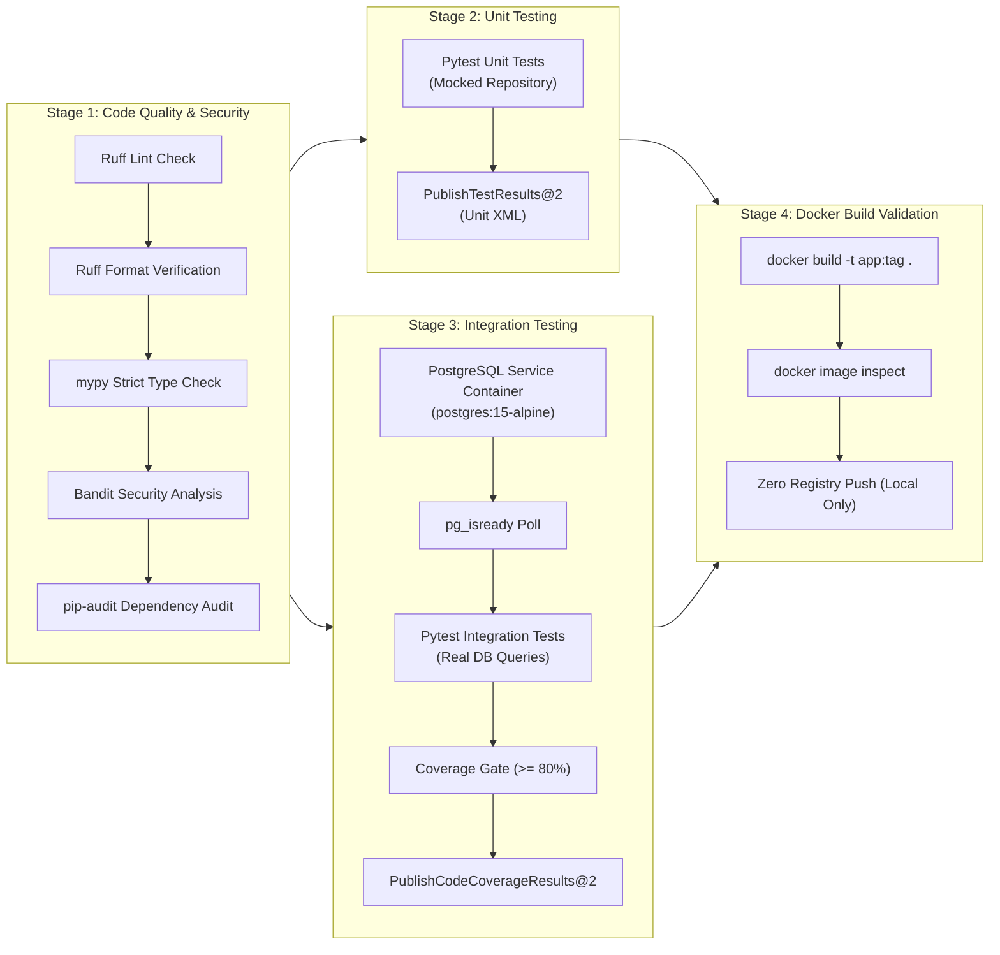

# FastAPI CI Project: Azure DevOps CI Pipeline

> **Production-grade Continuous Integration (CI) pipeline for a FastAPI microservice using Azure DevOps Pipelines.**

---

## 1. Project Objective & Scope

This project implements an end-to-end Continuous Integration (CI) pipeline validating code quality, type safety, security vulnerabilities, unit tests, PostgreSQL integration tests, 80% test coverage enforcement, and Docker build integrity.

### Scope Boundary
- ✅ **Continuous Integration (CI) only**: Validates software quality upon every commit and Pull Request.
- ❌ **Zero Continuous Deployment (CD)**: No deployments to VMs, App Services, or Kubernetes.
- ❌ **Zero Registry Push**: Docker images are compiled on the Azure build agent locally to prove buildability, with zero pushes to ACR, Docker Hub, or any registry.
- ❌ **No Reusable Templates**: This project focuses on application-specific pipelines first before extracting shared templates.

---

## 2. Architecture & File Structure

```text
fastapi-ci-project/
│
├── .azure-pipelines/
│   └── azure-pipelines.yml       # Complete 4-stage Azure DevOps CI pipeline
│
├── app/
│   ├── __init__.py
│   ├── main.py                   # FastAPI application factory & router inclusion
│   ├── api/
│   │   ├── __init__.py
│   │   └── routes.py             # HTTP controllers (/health, POST /users, GET /users/{id})
│   ├── services/
│   │   ├── __init__.py
│   │   └── user_service.py       # Domain business logic (uniqueness checks, error handling)
│   ├── repositories/
│   │   ├── __init__.py
│   │   └── user_repository.py    # SQLAlchemy database access queries
│   ├── models/
│   │   ├── __init__.py
│   │   └── user.py               # SQLAlchemy ORM entity & Pydantic DTO schemas
│   ├── database/
│   │   ├── __init__.py
│   │   └── connection.py         # SQLAlchemy engine, SessionLocal, and get_db provider
│   └── core/
│       ├── __init__.py
│       └── config.py             # Pydantic BaseSettings loading environment variables
│
├── tests/
│   ├── conftest.py               # Shared pytest fixtures (TestClient, db_session)
│   ├── unit/
│   │   ├── __init__.py
│   │   └── test_user_service.py  # Fast in-memory unit tests with mock repository
│   └── integration/
│       ├── __init__.py
│       ├── test_user_repository.py # Real PostgreSQL database persistence tests
│       └── test_api_endpoints.py   # Full HTTP endpoint integration tests
│
├── pyproject.toml                # PEP 621 packaging metadata & tool configurations
├── requirements.txt              # Production application dependencies
├── requirements-dev.txt          # Development, testing, and security tool dependencies
├── pytest.ini                    # Pytest configuration, discovery paths, and markers
├── Dockerfile                    # Multi-stage production container definition
├── .dockerignore                 # Excludes secrets, .env, .git, and test artifacts
├── .gitignore                    # Git file exclusions
├── .env.example                  # Template environment configuration
└── README.md                     # Comprehensive project documentation
```

### Layered Application Architecture

```text
HTTP Request
     |
     v
[ app/api/routes.py ]           <- Validates HTTP request/response DTOs
     |
     v
[ app/services/user_service.py ] <- Executes business rules (e.g. duplicate email check)
     |
     v
[ app/repositories/user_repo.py ] <- Executes database queries via SQLAlchemy
     |
     v
[ PostgreSQL Database ]         <- ACID Relational Storage
```

---

## 3. The 4 Pipeline Stages in Azure DevOps



---

## 4. Testing Strategy: Unit vs. Integration

### Why Unit Tests Must NOT Depend on a Real Database
1. **Execution Speed**: Unit tests execute in under 1 millisecond per test. If 500 unit tests require connecting to a database, test suites slow down from seconds to several minutes, destroying developer feedback loops.
2. **Determinism & Isolation**: Database state leaks across tests if rollbacks fail. Mocking the repository isolates the business logic from network latency, table locking, and connection pool timeouts.
3. **Failure Locality**: If a unit test fails, you know the flaw is inside your business logic, not a dead database service or corrupt table index.

### Integration Tests: Real PostgreSQL Validation
Integration tests verify what mocks hide:
- Do SQLAlchemy column constraints match the database schema?
- Are foreign keys and unique constraints (`IntegrityError`) enforced?
- Does the transaction rollback work properly under error conditions?

In Azure DevOps, integration tests bind to an automated **service container** (`resources.containers.postgres_service`) and wait for readiness using `pg_isready`.

---

## 5. Test Execution vs. Measuring Coverage vs. Coverage Enforcement

* **Executing Tests**: Runs pytest assertions to verify expected application behavior.
* **Measuring Coverage**: Calculates the ratio of executed source code statements against total statements (`Stmts / Miss`).
* **Enforcing a Coverage Threshold (`--cov-fail-under=80`)**: Converts coverage from an informative metric into a hard quality gate. If total coverage is 79.9%, the pipeline immediately exits with a non-zero exit code and fails the build.

---

## 6. Code Quality & Security Tools Explained

| Tool | Category | What It Detects | Response to Findings |
| :--- | :--- | :--- | :--- |
| **Ruff** | Linter & Formatter | PEP 8 violations, unused imports, anti-patterns, unformatted code. | Run `ruff check --fix .` and `ruff format .` |
| **mypy** | Type Checker | Type mismatches, invalid `None` handling, incompatible return types. | Add explicit type annotations or fix logic error. |
| **Bandit** | Static Security | Hardcoded passwords, SQL injection vulnerabilities, insecure hash algorithms (`MD5`), shell injection. | Refactor code to use secure libraries or parameterized queries. |
| **pip-audit** | Dependency Security | Known vulnerabilities (CVEs) in third-party packages in `requirements.txt`. | Upgrade vulnerable library to patched release version. |

---

## 7. Local Verification Guide (Windows PowerShell)

Run these commands locally to verify the entire project before pushing to Azure DevOps:

### Step 1: Create Virtual Environment & Install Dependencies
```powershell
# Create virtual environment
python -m venv .venv

# Activate virtual environment
.venv\Scripts\Activate.ps1

# Install development dependencies
pip install -r requirements-dev.txt
```

### Step 2: Run Linting and Formatting Checks
```powershell
# Lint check
ruff check .

# Formatting check (without modifying files)
ruff format --check .
```

### Step 3: Run Static Type Checking (mypy)
```powershell
mypy app
```

### Step 4: Run Security Audits (Bandit & pip-audit)
```powershell
# AST Security scan
bandit -r app -c pyproject.toml

# Dependency vulnerability audit
pip-audit -r requirements.txt
```

### Step 5: Run Unit Tests (In-Memory Isolation)
```powershell
pytest tests/unit -m unit -v
```

### Step 6: Run Integration Tests & Verify Coverage Threshold
```powershell
pytest tests/integration -m integration -v --cov=app --cov-fail-under=80 --cov-report=term-missing
```

### Step 7: Validate Docker Container Build Locally
```powershell
docker build -t fastapi-ci-app:local .
docker image inspect fastapi-ci-app:local
docker rmi fastapi-ci-app:local
```

---

## 8. Differences: Local Workflow vs. Azure Pipelines Workflow

| Feature | Local Development (Windows) | Azure DevOps Pipeline (Linux Agent) |
| :--- | :--- | :--- |
| **Operating System** | Windows (PowerShell) | `ubuntu-latest` (Bash) |
| **Database Container** | In-memory SQLite fallback or local Docker Compose | Azure Pipelines native service container (`postgres:15-alpine`) |
| **PostgreSQL Readiness** | Manual check or sleep | Automated loop polling `pg_isready -h localhost` |
| **Reporting** | Console output | Native Azure DevOps **Tests** and **Code Coverage** visual dashboards via `PublishTestResults@2` and `PublishCodeCoverageResults@2` |
| **Execution Trigger** | Manual terminal execution | Automated on every Git push and Pull Request |
