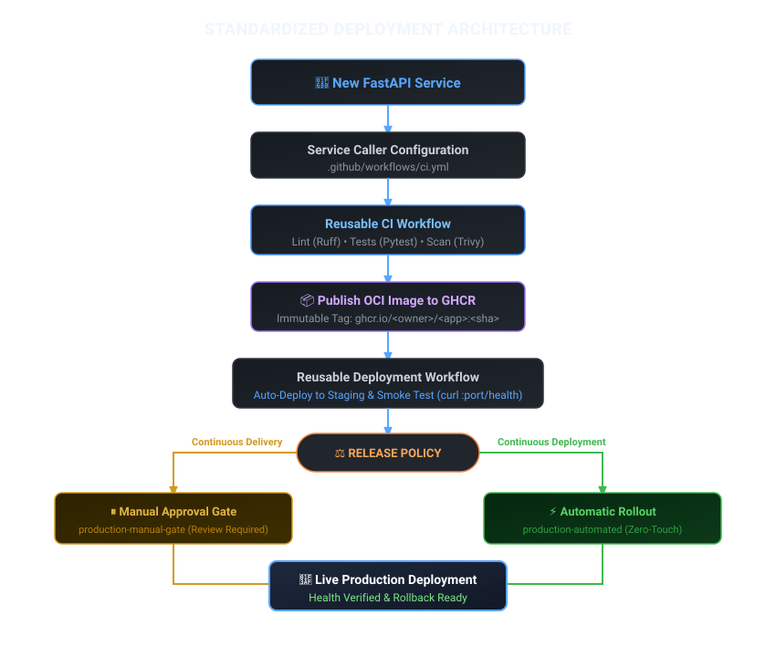

# Standardized CI/CD & Deployment Platform Manual
> **Unified Pipeline & Deployment Standard for Containerized FastAPI Microservices**
 
---

## 1. Platform Overview & Architecture

This platform standardizes software delivery across all FastAPI microservices. Instead of each service maintaining custom CI/CD scripts, the architecture cleanly separates **service configuration** from the **central deployment engine**.

### Architecture Flowchart



### Core Principles

* **Configuration, Not Code**: New services declare their configuration inputs (ports, routes, thresholds) in a caller workflow; the shared reusable engine handles execution.
* **Immutable Versioning**: Every production build is tagged with the exact Git commit SHA (`<image>:<commit-sha>`) or referenced by cryptographic digest (`@sha256:...`). We never deploy untracked or mutable code to production.
* **Safe by Default**: Microservices default to **Continuous Delivery** with a human approval gate for production releases. Zero-touch continuous deployment must be explicitly opted into.
* **Strict Branch Isolation**: Pull Requests test and validate code in complete isolation without publishing images or modifying deployment environments.

### Branch Execution & Security Matrix

| Pipeline Stage | Pull Request (PR) | Push to `main` Branch | Purpose & Controls |
|:---|:---:|:---:|:---|
| **Ruff Linter** | Yes | Yes | Validates Python syntax, PEP 8 compliance, and import order. |
| **Pytest Suite** | Yes | Yes | Runs isolated unit tests (100% pass required). |
| **Code Coverage Gate** | Yes | Yes | Fails build if test coverage is below configured threshold (e.g. 80%). |
| **HTML Coverage Upload** | Yes | Yes | Generates downloadable artifact (`coverage-report-<service>`) retained 30 days. |
| **Local Docker Build** | Yes | Yes | Verifies Dockerfile compiles and packages build successfully. |
| **Runtime Smoke Test** | Yes | Yes | Boots container in runner and checks `<health-endpoint>` responsiveness. |
| **Trivy CVE Audit** | Yes | Yes | Scans OS packages and Python wheels for `HIGH` and `CRITICAL` flaws. |
| **Publish to GHCR (`ghcr.io`)** | **Blocked** | **Enabled** | Pushes `:<commit-sha>` and `:latest` images to GitHub Container Registry. |
| **Staging Deployment** | **Blocked** | **Enabled** | Automatically deploys image to Staging and verifies live health check. |
| **Production Rollout** | **Blocked** | **Enabled** | Deploys to Production via manual approval gate or automated rollout. |

---

## 2. The Service Deployment Contract

A **deployment contract** is the strict specification of inputs that every service passes to the reusable pipeline. The contract inputs and the caller configuration have an exact **1-to-1 match**:

### Standard Contract Inputs Table

| Input Parameter | Type | Required | Default | Description | Example Value |
|:---|:---|:---|:---|:---|:---|
| `working-directory` | `string` | No | `"."` | Relative path to service source folder | `"services/<service-name>"` |
| `python-version` | `string` | No | `"3.11"` | Python runtime version | `"3.11"` |
| `min-coverage` | `number` | No | `80` | Minimum test coverage threshold (%) | `85` |
| `image-name` | `string` | No | `"app"` | Docker image name in registry (lowercase) | `"<service-name>"` |
| `app-port` | `number` | No | `8000` | Port container exposes and listens on | `8080` |
| `health-endpoint` | `string` | No | `"/health"` | Route used to verify container responsiveness | `"/health"` or `"/healthz"` |
| `push-image` | `boolean` | No | `true` | Whether to publish image to GHCR on main branch | `true` |
| `deployment-type` | `string` | No | `"delivery"` | Release strategy: `"delivery"` (approval gate) or `"deployment"` (auto) | `"delivery"` |

---

### 1. The Called Reusable Workflow Structure (`.github/workflows/reusable-pipeline.yml`)

> [!NOTE]
> **Illustrative Architectural Structure**: The snippet below illustrates the inputs, triggers, job sequence, and conditional gates. For the complete executable workflow (including step actions, Docker buildx setup, and cache tuning), refer to [`.github/workflows/reusable-pipeline.yml`](../.github/workflows/reusable-pipeline.yml).

```yaml
name: Reusable Python & Docker Pipeline

# Trigger: Accepts inputs from any caller workflow
on:
  workflow_call:
    inputs:
      working-directory: { required: false, type: string, default: "." }
      python-version:    { required: false, type: string, default: "3.11" }
      min-coverage:      { required: false, type: number, default: 80 }
      image-name:        { required: false, type: string, default: "app" }
      app-port:          { required: false, type: number, default: 8000 }
      health-endpoint:   { required: false, type: string, default: "/health" }
      push-image:        { required: false, type: boolean, default: true }
      deployment-type:   { required: false, type: string, default: "delivery" }

jobs:
  # ==========================================================
  # JOB 1: CI Quality Gates (Runs on PR & Main)
  # ==========================================================
  test:
    name: Lint, Test & Coverage
    runs-on: ubuntu-latest
    # Steps: checkout, setup-python, ruff check, pytest with coverage, upload htmlcov

  # ==========================================================
  # JOB 2: Container Build, Smoke Test & Security Audit
  # ==========================================================
  docker-build:
    name: Build, Verify & Publish Container
    needs: test
    runs-on: ubuntu-latest
    # Steps: build Docker image, runtime smoke test, Trivy CVE scan (HIGH,CRITICAL),
    # and publish to ghcr.io (guarded: inputs.push-image && main branch only)

  # ==========================================================
  # JOB 3: Staging Deployment & Live Smoke Test
  # ==========================================================
  deploy-staging:
    name: "CD: Auto-Deploy & Smoke Test on Staging"
    needs: docker-build
    if: (github.ref == 'refs/heads/main' || github.event_name == 'release')
    environment:
      name: staging
      url: http://staging.internal:${{ inputs.app-port }}${{ inputs.health-endpoint }}
    # Steps: pull image from ghcr.io, run container, verify live health check

  # ==========================================================
  # JOB 4A: Production Release via Continuous Delivery (Manual Gate)
  # ==========================================================
  deploy-production-gated:
    name: "CD (Delivery): Production Release (Manual Approval)"
    needs: deploy-staging
    if: inputs.deployment-type == 'delivery' && (github.ref == 'refs/heads/main' || github.event_name == 'release')
    environment:
      name: production-manual-gate # Pauses execution until authorized reviewer approves
      url: http://production.internal:${{ inputs.app-port }}${{ inputs.health-endpoint }}
    # Steps: deploy verified image to production cluster upon approval

  # ==========================================================
  # JOB 4B: Production Release via Continuous Deployment (Automated)
  # ==========================================================
  deploy-production-automated:
    name: "CD (Deployment): 100% Automated Production Rollout"
    needs: deploy-staging
    if: inputs.deployment-type == 'deployment' && (github.ref == 'refs/heads/main' || github.event_name == 'release')
    environment:
      name: production-automated # Automated deployment record
      url: http://production.internal:${{ inputs.app-port }}${{ inputs.health-endpoint }}
    # Steps: direct zero-touch rollout to production cluster
```

---

### 2. The Caller Workflow Structure (`.github/workflows/ci.yml`)

The **caller workflow** resides in the root repository. It triggers on Git events and delegates execution to the reusable workflow for each microservice:

```yaml
name: Multi-Project CI/CD Pipeline

on:
  push:
    branches: [ "main" ]
  pull_request:
    branches: [ "main" ]

permissions:
  contents: read
  packages: write

jobs:
  <service-name>-ci:
    name: "Service: <service-name>"
    uses: ./.github/workflows/reusable-pipeline.yml
    with:
      working-directory: "services/<service-name>"
      python-version: "3.11"
      min-coverage: 80
      image-name: "<service-name>"
      app-port: 8000
      health-endpoint: "/health"
      push-image: true
      deployment-type: "delivery" # "delivery" (safe gated default) or "deployment" (auto)
```

---

## 3. Step-by-Step Pipeline Flow

Following the architecture flowchart, every code change progresses through a standardized 5-step lifecycle:

---

### Step 1: Code Verification & Quality Gates (CI)
* **Linter (Ruff)**: Performs static analysis, checking PEP 8 syntax, imports, and common anti-patterns. Fails fast in milliseconds if linting errors occur.
* **Test Isolation Strategy**:
  * **Unit Tests**: Fast, in-memory pytest test cases mocking databases and third-party APIs. Every PR must have 100% passing unit tests.
  * **Integration Tests**: Tests verifying multi-component behavior with test containers or mock servers.
* **Coverage Enforcement (`--cov-fail-under`)**: Enforces minimum test coverage (e.g., 80% or 85%). If coverage falls below the threshold, the pipeline immediately halts.
* **Coverage Artifact Upload**: Generates an HTML report (`htmlcov`) and publishes it as a downloadable GitHub Actions artifact named `coverage-report-<service-name>` with a 30-day retention period.

---

### Step 2: Build, Verify & Publish Container to GHCR
* **Docker Build**: Compiles an optimized Linux container image from the service's `Dockerfile` using `pyproject.toml`.
* **Runtime Smoke Test**: Starts the newly built container in the runner and queries `http://localhost:<app-port><health-endpoint>` with `curl --fail` to ensure the container starts without crashing.
* **Security Scan (Trivy CVE Audit)**: Scans base OS layers and installed Python wheels for known security flaws.
  * Scans for vulnerabilities with severity levels `HIGH` and `CRITICAL`.
  * In production policy, critical vulnerabilities block publishing until patched.
* **GHCR Publishing Controls**:
  * Strictly guarded to pushes on `main` branch: PR builds never push images.
  * Image names are normalized to lowercase to satisfy OCI registry standards (`ghcr.io/<owner>/<service-name>`).
* **Image Tagging Architecture**:
  * **Mutable Pointer (`:latest`)**: Points to the most recent build. Useful for local developer pulls, but **not recommended for production releases**.
  * **Immutable Version (`:<commit-sha>`)**: Points directly to the source Git commit SHA (`${{ github.sha }}`). Guarantees exact build traceability, reproducible rollbacks, and zero ambiguity across concurrent builds.
  * **Cryptographic Digest (`@sha256:...`)**: Immutable image digest for strict supply-chain verification.

---

### Step 3: Staging Deployment & Smoke Testing
* Automatically triggered on pushes to `main` for **both** Delivery and Deployment strategies.
* Pulls the verified immutable image (`ghcr.io/<owner>/<service-name>:<commit-sha>`) into the **Staging** environment.
* Runs a live smoke test against `<health-endpoint>` to confirm operational readiness before production consideration.

---

### Step 4: Release Policy (Continuous Delivery vs. Continuous Deployment)
The pipeline branches based on the service's `deployment-type` configuration:

| Release Strategy | Pipeline Behavior | Recommended Use Cases |
|:---|:---|:---|
| **Continuous Delivery**<br>`deployment-type: "delivery"`<br>*(Default)* | Automatically verifies on Staging, then pauses at an **Approval Gate** (`production-manual-gate`). Authorized reviewers must click **Review deployments -> Approve and deploy**. | Core customer-facing APIs, billing, order processing, database migrations. |
| **Continuous Deployment**<br>`deployment-type: "deployment"` | Automatically verifies on Staging, then rolls out **100% automatically** to Production without human intervention. | Low-risk microservices, internal dashboards, mature services with comprehensive integration tests. |

#### Configuring the Approval Gate in GitHub
To enforce the approval gate for Continuous Delivery:
1. Navigate to your repository on GitHub -> **Settings** -> **Environments**.
2. Click **New environment** and enter name: `production-manual-gate`.
3. Check **Required reviewers** and select team leads or release managers.
4. Save the environment. When the workflow runs, GitHub pauses at this step and waits for manual review.

---

### Step 5: Production Deployment & Verification
* The verified immutable image (`<image>:<commit-sha>`) is pulled into the Production environment.
* Post-deployment health verification runs against `<health-endpoint>` to confirm availability.
* If verification succeeds, the release is marked healthy. If health checks fail, alerts trigger and the rollback procedure is initiated.

---

## 4. Onboarding Checklist for New Services

To onboard a new FastAPI service into the CI/CD platform in under 5 minutes:

### Pre-flight Checklist
- [ ] Service code resides under `services/<new_service>/`.
- [ ] Dependencies declared in `pyproject.toml` (standard PEP 517 / PEP 621 format).
- [ ] Health endpoint (`/health` or `/healthz`) implemented and returns HTTP 200.
- [ ] Application binds to `0.0.0.0` on configured container port.
- [ ] Pytest suite achieves configured coverage threshold (`min-coverage`).
- [ ] GitHub Environment `production-manual-gate` configured if using delivery mode.

### Step 1: Service Directory Structure
```text
services/<new_service>/
 app/main.py             Exposes HTTP health endpoint (e.g. /health)
 tests/test_api.py       Pytest unit test suite
 Dockerfile              Multi-stage OCI container definition
 pyproject.toml          Dependencies and packaging metadata
 pytest.ini              Pytest configuration and discovery rules
```

### Step 2: Pytest Isolation (`pytest.ini`)
```ini
[pytest]
pythonpath = .
testpaths  = tests
addopts    = --import-mode=importlib
```

### Step 3: Add Service Block to `.github/workflows/ci.yml`
```yaml
  <service-name>-ci:
    name: "Service: <service-name>"
    uses: ./.github/workflows/reusable-pipeline.yml
    with:
      working-directory: "services/<service-name>"
      python-version: "3.11"
      min-coverage: 80
      image-name: "<service-name>"
      app-port: 8080
      health-endpoint: "/health"
      push-image: true
      deployment-type: "delivery" # "delivery" (safe default) or "deployment" (auto)
```

**Done!** Your new service immediately inherits linting, testing, CVE auditing, GHCR publishing, and staged deployments.

---

## 5. Emergency Operations & Container Runbook

> [!IMPORTANT]
> **Automated Deployments vs. Manual Runbook**:
> Standard releases are executed **100% automatically** by GitHub Actions upon merging code to `main`. This runbook is intended strictly for **local development inspection** or **emergency manual rollbacks on standalone hosts**.

### Note on Zero-Downtime Rollbacks
* The standalone Docker commands below (`docker stop && docker rm` followed by `docker run`) cause a brief container restart window.
* In a production cluster running an orchestrator (such as Kubernetes RollingUpdate, AWS ECS Blue/Green, or an upstream Nginx reverse proxy), zero-downtime is achieved by starting the new container and validating its health check *before* routing traffic away from the old container.

---

### Step 1: Authenticate to GHCR Locally
```bash
docker login ghcr.io -u YOUR_GITHUB_USERNAME
# Enter your GitHub Personal Access Token (PAT) with 'read:packages' permission
```

### Step 2: Pull and Run Any Service Locally
For reproducible testing, always pull by the exact Git commit SHA:

```bash
# Pull immutable build by Git SHA
docker pull ghcr.io/<owner>/<service-name>:<commit-sha>

# Run container with mapped port
docker run -d --name <service-name> -p <host-port>:<app-port> ghcr.io/<owner>/<service-name>:<commit-sha>

# Verify health endpoint
curl http://localhost:<host-port><health-endpoint>
```

### Step 3: Emergency Container Rollback
If a production issue occurs and a standalone container must be restored immediately to the previous known-good version:

```bash
# 1. Stop and remove the degraded container
docker stop <service-name> && docker rm <service-name>

# 2. Run the previous verified build by SHA
docker pull ghcr.io/<owner>/<service-name>:<previous-commit-sha>
docker run -d --name <service-name> -p <host-port>:<app-port> ghcr.io/<owner>/<service-name>:<previous-commit-sha>

# 3. Verify recovered container health
curl --fail http://localhost:<host-port><health-endpoint>
```

---  

*Standardized CI/CD & Deployment Platform Manual • GitHub Actions • Docker • GHCR • FastAPI*
